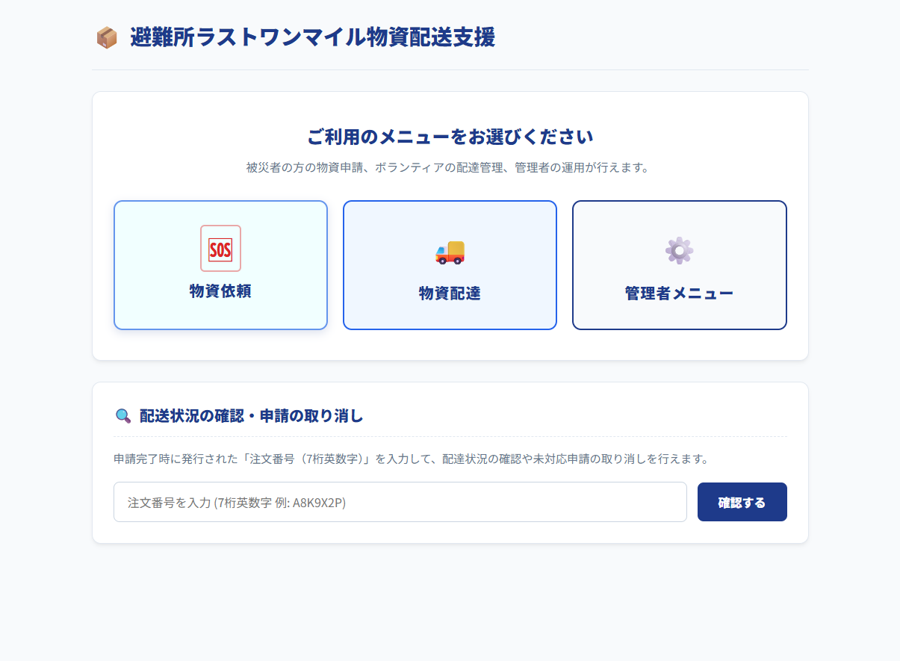
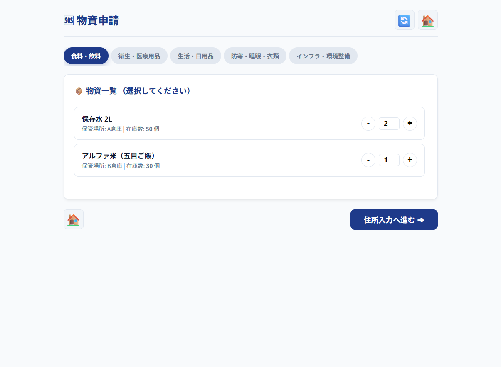
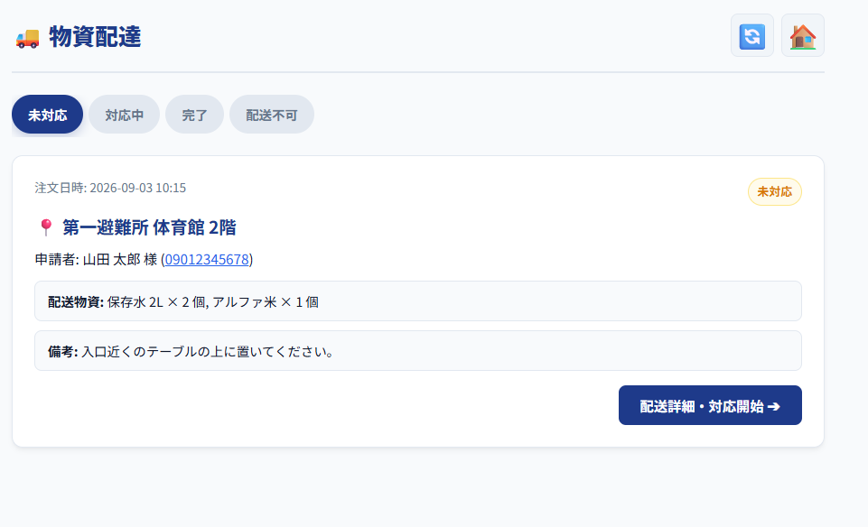
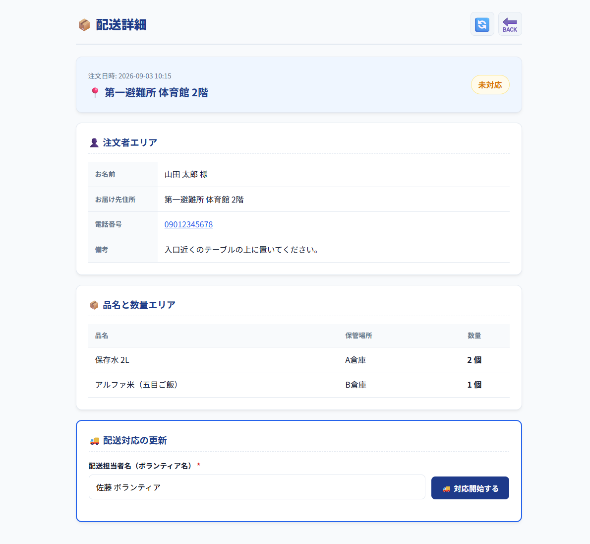
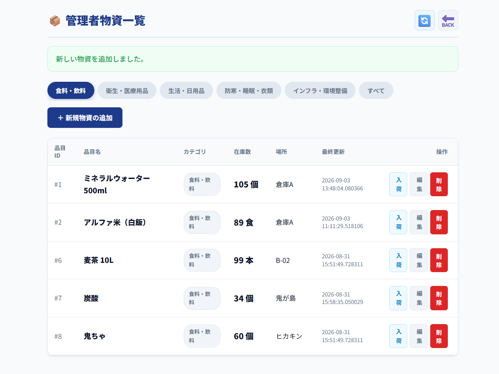
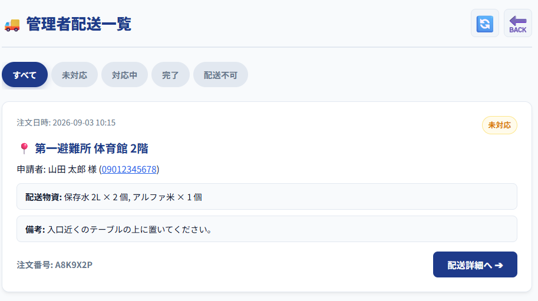
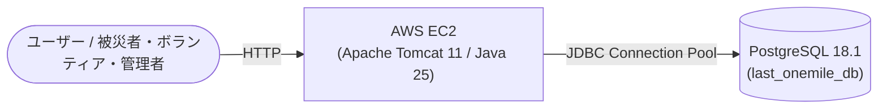
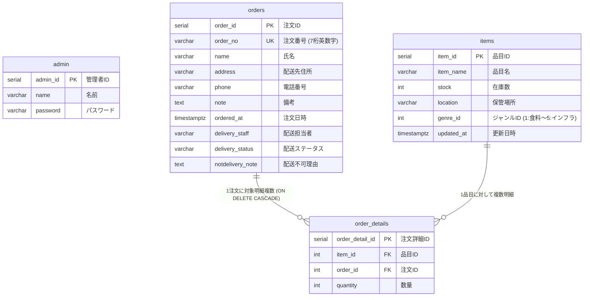

# アプリケーション「避難所ラストワンマイル物資配送支援アプリ」

[](https://openjdk.org/)
[](https://tomcat.apache.org/)
[](https://www.postgresql.org/)
[](https://aws.amazon.com/)
[](https://www.eclipse.org/)
[](https://a5m2.mmatsubara.com/)

災害発生時等における被災者への物資配送状況を最新の在庫状況に基づき可視化し、被災者からの物資申請、ボランティアによる配送支援、および管理者による全体統制をシームレスに行うための「ラストワンマイル配送支援Webアプリケーション」です。  
避難所や集積所から各家庭・個別の被災者へ物資が届くまでのボトルネック（ラストワンマイル問題）を解消し、効率的かつ迅速な支援を実現するために開発されました。


> **本プロジェクトは、避難所ラストワンマイル物資配送支援システムとして開発されたポートフォリオです。**  
> * **主要ターゲット**: 被災者、配送ボランティア、自治体・避難所管理者  

---
## 👤 担当・役割

4人チームで開発し、私はもう1人のメンバーと、主にプログラム設計を担当しました(画面設計とデータベース設計は、他の2人が担当)。

**・プログラム設計:** 機能ごとの動作条件と処理内容を、プログラムデザイン(PD)資料にまとめました。

**・AIを使った開発:** PD資料をもとにAntigravityでコードと画面を生成しました。動作が仕様と異なる場合は、PD資料と指示文を修正して生成し直しました。

**・コード解析:** 完成したソースを分担して読み、私は管理者確認フィルター、文字化け防止フィルター、共通エラーモーダルJSP、DB操作のDAOを担当しました。AIにも質問しながら処理の流れを確認し、メンバーに説明できるところまで理解を深めました。
## 📑 目次
1. [💻 画面イメージ](#-画面イメージ)
2. [✨ 主な機能](#-主な機能)
3. [🧰 使用技術・開発環境](#-使用技術開発環境)
4. [📐 システム構成](#-システム構成)
5. [🗄️ データベース設計（ER図）](#️-データベース設計er図)
6. [🌐 動作確認（デモ環境）](#-動作確認デモ環境)
7. [📖 要件定義書・画面設計書](#-要件定義書画面設計書)
8. [🛠️ ローカル環境での実行・セットアップ手順](#️-ローカル環境での実行セットアップ手順)
9. [💡 工夫した点](#-工夫した点)
10. [🧗 苦労した点・得られた教訓](#-苦労した点得られた教訓)
11. [🔧 今後の課題](#-今後の課題)
---

## 💻 画面イメージ

*(※ 掲載している画像はシステム画面の一部抜粋です。全画面イメージや詳細な画面フローは [要件定義書・画面設計書](#-要件定義書画面設計書) よりご覧いただけます)*

### 📦 1. 一般被災者向け画面
| トップ画面 (`top.jsp`) | 物資選択画面 (`order_items.jsp`) |
| :---: | :---: |
|  |  |
| 3つのロール動線および注文番号による状況確認入口 | カテゴリ別の物資一覧、在庫に応じた数量選択 |

---

### 🚚 2. ボランティア配送スタッフ向け画面
| ボランティア配送一覧画面 (`volunteer_list.jsp`) | ボランティア配送詳細画面 (`volunteer_detail.jsp`) |
| :---: | :---: |
|  |  |
| ステータス別（未対応・対応中・完了・配送不可）タスク一覧 | 担当者登録による対応開始、配送不可理由の登録 |

---

### 🔐 3. 管理者向け画面
| 管理者物資一覧画面 (`admin_items.jsp`) | 管理者配送一覧画面 (`admin_orders.jsp`) |
| :---: | :---: |
|  |  |
| 救援物資マスタ管理、在庫数の確認・各種操作 | システム内の全注文ステータス一覧・監視 |

---

## ✨ 主な機能

* 📦 **一般被災者向け機能**
  * **最新在庫に基づく物資申請**: カテゴリ別絞り込み（食料・飲料、衛生用品等）と現在庫数に基づく申請数量の選択
  * **配送先情報の登録**: 氏名・避難所や自宅の住所・連絡先電話番号・備考（アレルギーや要望等）の入力
  * **申請内容確認 & 二重送信防止**: トークン検証による誤操作・重複発注の防止とトランザクション在庫引き当て
  * **注文番号による配送状況追跡**: 自動発行された7桁の注文番号（例: `AD43`）による最新ステータス照会
  * **未対応時の申請取り消し**: 配送前（ステータス「未対応」）であれば被災者自身でキャンセル可能（在庫の自動棚戻し・復元）
* 🚚 **ボランティア（配送スタッフ）向け機能**
  * **ステータス別タスク一覧**: 「未対応」「対応中」「完了」「配送不可」のタブ切り替えによる優先配送業務の可視化
  * **対応開始（排他制御）**: 配送担当者名を入力して配送タスクを受領（他ボランティアとの重複対応を防止）
  * **配送結果更新**: 配送完了処理、または不在・道路不通等に伴う「配送不可」理由の登録（配送不可時は在庫を自動復元）
* 🔐 **管理者向け機能**
  * **安全なログイン認証**: セッション管理による管理者専用ダッシュボードへのアクセス制御
  * **救援物資・在庫マスタ管理**: 物資の新規追加、保管場所設定、編集、入荷加算処理、不要物資削除（注文履歴チェック付き）
  * **全体配送統制 & 誤申請削除**: 全注文の進捗監視、およびいたずら・誤入力申請の強制削除（在庫自動復元）

---

## 🧰 使用技術・開発環境

| カテゴリ | 技術スタック / バージョン / 補足 |
| :--- | :--- |
| **開発期間** | 26日 |
| **開発規模** | 約2.3Kstep（Java実効行）／ 総行数 約5.1Kstep（Java: 2,710行, JSP: 1,671行, CSS/XML: 707行） |
| **言語・ランタイム** | Java 25 (OpenJDK) |
| **Webコンテナ / APサーバ** | Apache Tomcat 11 |
| **バックエンドフレームワーク** | Java (Servlet / JSP / MVCモデル設計) |
| **ライブラリ** | PostgreSQL JDBC Driver 42.7.10, Jakarta Standard Taglib (JSTL) 3.0.1 |
| **データベース** | PostgreSQL 18.1（テーブル生成用 [create_tables.sql](create_tables.sql) を同梱） |
| **インフラ / ホスティング** | AWS (EC2: Amazon Linux) / Apache Tomcat 11 ※検証用パブリックIPで公開(独自ドメイン・SSL暗号化は今後の課題)
| **統合開発環境 (IDE)** | Eclipse |
| **DB管理・設計ツール** | A5:SQL Mk-2 |
| **開発支援（AI）** | Antigravity |

---

## 📐 システム構成



---

## 🗄️ データベース設計（ER図）

本システムは、物資の在庫管理および注文・配送ステータスを整合性を保って管理するため、正規化を意識して4つのテーブルで構成されるよう設計。



| テーブル名 | 論理名 | 主な役割 |
| :--- | :--- | :--- |
| `admin` | 管理者 | 管理者ログイン認証情報（ID・氏名・パスワード） |
| `items` | 物資 | 救援物資マスタ。品目名、在庫数（stock）、保管場所、ジャンルを管理 |
| `orders` | 注文 | 被災者情報、配送ステータス（未対応/対応中/完了/配送不可）、担当者、注文番号（order_no）を管理 |
| `order_details` | 注文詳細 | 各注文と物資品目の紐付けおよび申請数量（quantity）を管理（注文削除時はカスケード削除） |

---

## 🌐 動作確認（デモ環境）

訓練校のAWS環境で公開していましたが、訓練期間終了に伴い環境が初期化されたため、現在は公開を停止しています。画面の様子は上記スクリーンショットと、要件定義書・画面設計書(GitHub Pages)でご確認いただけます。

---

## 📖 要件定義書・画面設計書

👉 **[Web版 要件定義書・画面設計書はこちら（GitHub Pages）](https://kishiya0618.github.io/project/)**  
*(※リンクを別タブで開く場合は `Ctrl + クリック`（Macは `Cmd + クリック`）してください)*  
*(※リポジトリ同梱の `画面遷移図.html` にて、システム仕様・各画面イメージ・業務フローの詳細をWebブラウザ形式で直接ご覧いただくことも可能です)*

---

## 🛠️ ローカル環境での実行・セットアップ手順

ローカル環境で本プロジェクトを実行する場合は、以下の環境準備、データベースのセットアップ、およびデータベース接続設定が必要です。

### 1. 前提条件
* **Java**: JDK 25
* **Webコンテナ**: Apache Tomcat 11
* **データベース**: PostgreSQL 18.1
  * ※ プログラムを実行する際に必要な環境として、データベースのテーブル生成用DDL（[`create_tables`](create_tables.sql)）をプロジェクトルート直下に同梱しています。

### 2. データベースの構築（テーブル生成用DDLの実行）
プログラムの実行に必要なテーブル群を生成するため、公開しているテーブル生成用DDL（[`create_tables`](create_tables.sql)）を実行してください。

1. PostgreSQLにて任意のデータベース（例: `last_onemile_db`）を作成します。
2. 作成したデータベースに対して、プロジェクトルート直下の [`create_tables`](create_tables.sql) を実行してテーブルおよび初期データを作成します。  
   *(※ A5:SQL Mk-2、pgAdmin、または `psql` コマンドライン等から実行可能です)*

### 3. データベース設定ファイルの作成
セキュリティ保護のため接続設定ファイル自体はリポジトリ管理外（または環境依存）となっています。  
`/src/main/java/` 配下に `db.properties` を作成（または同梱の `db.properties.sample` をリネーム）し、ご自身のローカルDB環境に合わせて接続情報を設定してください。

#### `db.properties` の記述例
```properties
db.url=jdbc:postgresql://localhost:5432/last_onemile_db
db.user=postgres
db.password=ご自身のパスワード
db.driver=org.postgresql.Driver
```

---

## 💡 工夫した点

### 1. 在庫の自動連動・復元ロジック
物資の申請確定時だけでなく、被災者自身による「未対応キャンセルの実行」や、配送ボランティアによる「配送不可判定」、管理者による「誤申請データの削除」が行われた際に、該当する物資の在庫数（`stock`）がDB上で自動的に加算・復元される整合性ロジックを共通化・徹底しました。

### 2. 悲観的排他制御（行ロック）とデッドロック防止ソートの実装
* **デッドロック防止**: 複数物資を同時に申請する際、物資IDの昇順（`cart.sort(Comparator.comparingInt(CartItem::getItemId))`）でソートしてからロックを取得することで、同時注文時のデッドロックを防止。
* **在庫の悲観的ロック**: 注文確定トランザクション内で `SELECT ... FOR UPDATE` を発行して在庫行を排他ロックし、残数チェックと引き当て減算をアトミックに実行することで、在庫の過剰引き当てを防ぐ設計としました。

### 3. 二重送信防止（ワンタイムCSRFトークン ＆ PRGパターン）
* `CsrfTokenUtil` によるワンタイムCSRFトークンを発行・検証し、外部からの不正リクエストおよびブラウザの戻る操作や二重サブミットを防御。
* 注文完了画面への遷移には **PRG（Post-Redirect-Get）パターン** を採用し、完了後のブラウザ再読み込みによる重複注文の発生を未然に排除しました。

### 4. 現場混乱を防ぐステータス競合制御と共通エラーモーダル
避難所現場において、複数のボランティアが同一の未対応タスクに同時に着手しようとした場合、先着の1名のみを受領とし、後着の担当者には「他の担当者が既に対応を開始しました」という共通エラーモーダル（`common_error_modal.jsp`）を表示して最新一覧へ自動リロードさせる安全設計としました。

### 5. 役割に応じた直感的UI/UXとステータス絞り込みタブ
緊急時でも迷わず操作できるよう、「被災者」「ボランティア」「管理者」の3つの動線をトップ画面で明確に分離しました。ボランティアおよび管理者画面では、対応ステータス（未対応・対応中・配送不可・完了）ごとのタブ切り替え機能を実装し、優先すべき配送タスクが一目で把握できる設計としています。

---

## 🧗 苦労した点・得られた教訓

初めてのチーム開発およびAIを活用した開発プロセス（AI協調型開発）において、以下の点に苦慮し、大きな学びと成長を得ることができました。

### 1. チーム開発におけるコミュニケーションと合意形成の難しさ
初めてのチーム開発において、自分の考えや仕様に関するアイデアをメンバーへ正確に伝える難しさを実感しました。
* **課題と反省**: 
  自分の意図がうまく伝わらない焦りから口調が強くなってしまう場面があり、コミュニケーションの取り方や表現方法について深く反省・模索しました。説明をする際、相手に伝わらない場合は何が分からなかったのかを聞くことで円滑に進められるようになると学びました。

* **対策と得られた教訓**: 
  相手にわかりやすく伝えるためには、「まず自分自身が技術や仕様に対する深い知識と正確な理解を持つこと」が不可欠であると痛感しました。感覚的な説明ではなく、仕様や根拠を整理してロジカルに伝える意識を持つことで、円滑な合意形成を図る重要性を学びました。

### 2. AI生成コードの解析とシステム構造の把握
Antigravity（AI）によるコーディングを活用したことで、凡ミスや構文エラーなどのイシューを排除して開発速度を飛躍的に向上させることができた反面、生成されたソースコードの全容把握に時間を要しました。
* **課題と対応**: 
  各ファイルの責務や処理実行時におけるデータの流れ（データフロー）を正しく理解するため、メンバー間で分担してコード解析を実施しました。
* **成長と得られた教訓**: 
  自分の担当部分だけでなく、他メンバーが担当したファイルも含めてコードを読み、システム全体の役割やデータの流れを、メンバーに説明できるところまで理解を深めました。

### 3. AIが生成するプログラムの品質確保
PD資料の記載内容に曖昧な箇所があると、AIによって想定外のロジックが組み込まれる事象が多発しました。
* **対策と得られた教訓**: 
  その都度PD資料を加筆修正し、AIにて再生成を行うプロセスを繰り返しました。この経験から、「PD資料が満たすべき必要十分条件の重要性」や、「コード修正時には必ずPD資料へフィードバックを行うこと」、また「全機能を再作成させるか一部機能のみを再作成するかの判断基準の必要性」を学びました。

### 4. 複数ユーザー（被災者・配送者・管理者）の同時操作によるデータの競合制御
避難所現場において、被災者の申請キャンセルとボランティアの配送対応開始が同時に発生した場合のデータ不整合（ステータスの食い違いや在庫の二重減算など）の防止に苦慮しました。
* **対策と得られた教訓**: 
  「未対応」の場合のみキャンセルや編集を許可し、処理実行時には状態チェックを行うなど、「トランザクション管理とステータス遷移の厳密化」を図りました。また、他者により更新があった場合には画面更新を促すメッセージを出すなど、「適切なユーザーフィードバック・モーダル設計」の必要性を学びました。

## 🔧 今後の課題

* **管理者パスワードの保存方法**: 現在は平文で保存しています。ハッシュ化して保存する形に改善したいと考えています(パスワードの列は255文字で、ハッシュ値を保存できる長さにしてあります)。
* **通信の暗号化**: 検証環境はHTTPで公開していました。独自ドメインとSSL(HTTPS)に対応したいと考えています。
---
これらの経験と教訓は、実務におけるチーム開発やAI協調型開発、設計資料をもとにした開発においても非常に役立つ大きな知見であると確信しています。

